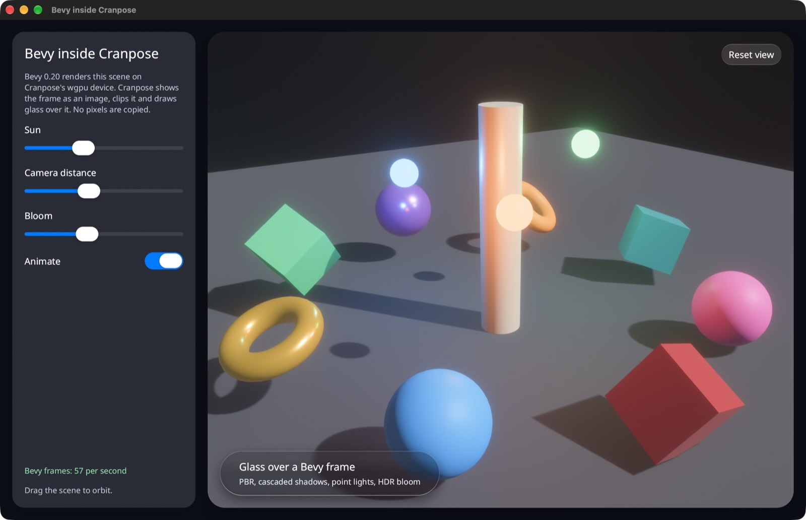
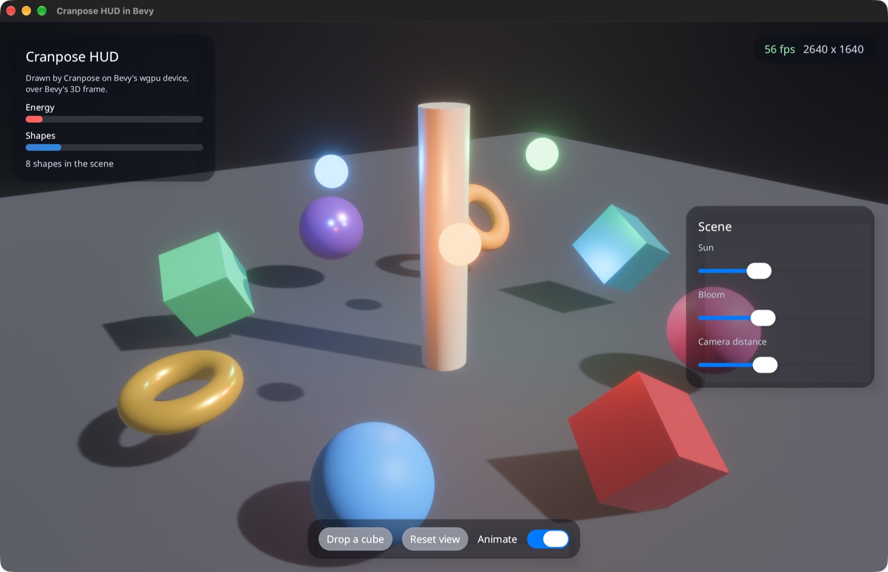

# Engine examples

Cranpose and game engines on one GPU device, in both directions. Tracked in
[#1412](https://github.com/samoylenkodmitry/Cranpose/issues/1412).

| Example | What it shows |
| --- | --- |
| `bevy-in-cranpose` | A Bevy 0.20 scene with cascaded shadows, point lights and HDR bloom inside a Cranpose window. Cranpose clips it, casts a shadow around it and draws glass over it. Drag the scene to orbit. |
| `cranpose-hud-bevy` | A Bevy game window with a Cranpose HUD over the 3D scene. The HUD reads game state, sends commands back, and takes only the clicks that land on it. |





Run them from this directory:

```sh
cargo run -p bevy-in-cranpose
cargo run -p cranpose-hud-bevy
```

## How the device is shared

Bevy 0.20 builds against wgpu 30, the release Cranpose's fork starts from.
`wgpu-shim` is a package named `wgpu` that re-exports the fork, and the
workspace patches crates.io's `wgpu` with it. Bevy and Cranpose then use one
`wgpu::Device` type and one device, so frames pass between them as textures,
with no copies and no unsafe code. Cargo ignores a `[patch]` entry that renames
a package, so the re-export package is needed.

- **Bevy inside Cranpose.** `cranpose_bevy::BevyView` creates Bevy's renderer
  from Cranpose's device (`cranpose::gpu_context()`) without a window or
  pipelined rendering, renders into a texture, and hands each frame to Cranpose
  as an `ExternalTexture` frame. The app asks the window's device for Bevy's
  features with `AppLauncher::with_gpu_requirements`.
- **Cranpose HUD in Bevy.** `cranpose_bevy::hud::CranposeHudPlugin` creates a
  `GuestView` on Bevy's device, draws it into a Bevy image each frame, and
  shows that image over the scene with premultiplied alpha. `HudPointer` tells
  the game whether the HUD took the current press.
