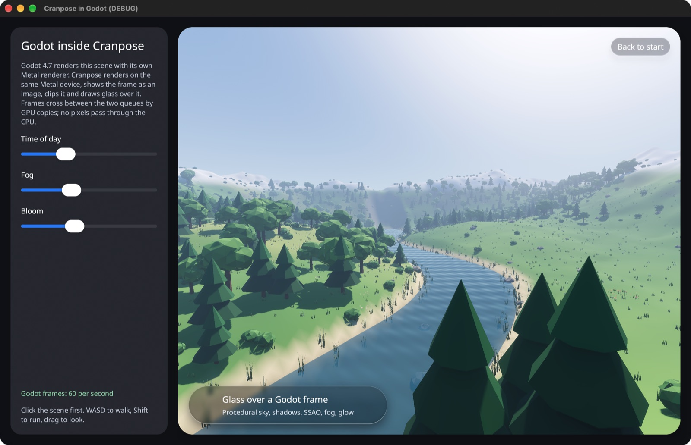
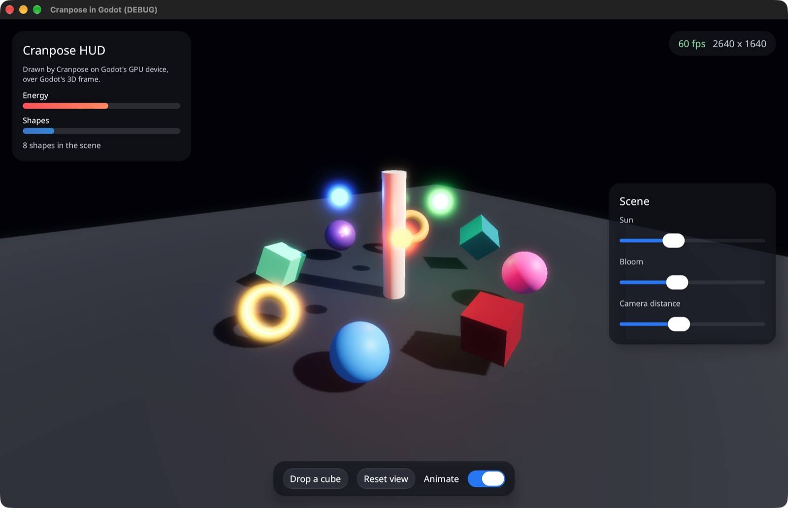

# Engine examples

Cranpose and game engines on one GPU device, in both directions. Tracked in
[#1412](https://github.com/samoylenkodmitry/Cranpose/issues/1412).

| Example | What it shows |
| --- | --- |
| `bevy-in-cranpose` | Bevy 0.20 draws the valley (Earth atmosphere, cascaded shadows, fog, bloom) inside a Cranpose window. Cranpose clips it, casts a shadow around it and draws glass over it. |
| `cranpose-hud-bevy` | A Bevy game window with a Cranpose HUD over the valley. The HUD reads game state (stamina, altitude), sends commands back, and takes only the clicks that land on it. |
| `cranpose-godot` | A Godot 4.7 extension with both directions: `window.tscn` shows Godot's 3D scene inside a Cranpose window, `hud.tscn` draws a Cranpose HUD over it. macOS with Metal. |






Run them from this directory:

```sh
cargo run -p bevy-in-cranpose
cargo run -p cranpose-hud-bevy
cargo build -p cranpose-godot
godot --path cranpose-godot/project --import
godot --path cranpose-godot/project res://window.tscn
godot --path cranpose-godot/project res://hud.tscn
```

Build and run each example with its own `cargo` command. One command for both
Bevy examples merges their Bevy features, and `bevy-in-cranpose` then carries
the game's windowing and gamepad polling.

The editor's first import builds the extension list; Godot 4.7.2's headless
import can crash after that step while it loads the editor layout, which
leaves the project ready to run.

All four show the same place, generated by the `nature` crate: a valley with a
winding river, trees, bushes, flower meadows, grass, reeds and rocks, closed by
mountains. Walk with WASD or the arrow keys, run with Shift, and drag to look.
Inside a Cranpose window, click the scene first so it has the keyboard focus.

## How the device is shared

Bevy 0.20 builds against wgpu 30, the release Cranpose's fork starts from.
`wgpu-shim` is a package named `wgpu` that re-exports the fork, and the
workspace patches crates.io's `wgpu` with it. Bevy and Cranpose then use one
`wgpu::Device` type and one device, so frames pass between them as textures,
with no copies and no unsafe code. Cargo ignores a `[patch]` entry that renames
a package, so the re-export package is needed.

- **Bevy inside Cranpose.** `cranpose_bevy::BevyView` creates Bevy's renderer
  from Cranpose's device (`cranpose::gpu_context()`) without a window or
  pipelined rendering, renders into a texture, and hands each frame to Cranpose
  as an `ExternalTexture` frame. The app asks the window's device for Bevy's
  features with `AppLauncher::with_gpu_requirements`.
- **Cranpose HUD in Bevy.** `cranpose_bevy::hud::CranposeHudPlugin` creates a
  `GuestView` on Bevy's device, draws it into a Bevy image each frame, and
  shows that image over the scene with premultiplied alpha. `HudPointer` tells
  the game whether the HUD took the current press.

## How Godot is bridged

Godot renders through its own Metal driver, so Cranpose cannot share its
`wgpu::Device`. `cranpose-gpu-interop`, the one crate with unsafe code, builds
a wgpu device on Godot's `MTLDevice` from the handles
`RenderingDevice.get_driver_resource` returns.

Cranpose submits to a queue of its own. wgpu opens a Metal command buffer for
each pass and holds them until it submits, and Godot's queue allows 64
uncompleted command buffers, which Godot and a Cranpose frame with glass
together exhaust. Each frame, one command buffer on Godot's queue hands the
textures over:

- **Godot to Cranpose:** it waits for Cranpose's last frame, copies the
  `SubViewport` texture into a texture Cranpose samples, and signals an event
  that Cranpose's next submit waits for.
- **Cranpose to Godot:** it waits for the event Cranpose's frame signals and
  copies the frame into the texture a `TextureRect` shows. Godot's own command
  buffers that read it come later on the same queue, so Metal orders them
  after the copy.

The copies run on the GPU; no pixels pass through the CPU.
